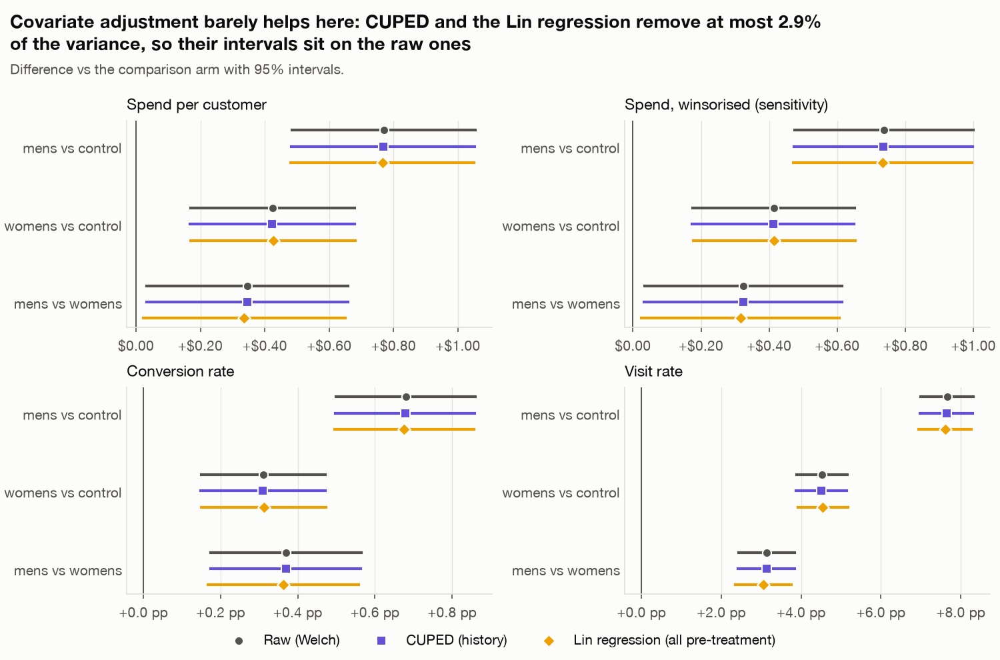
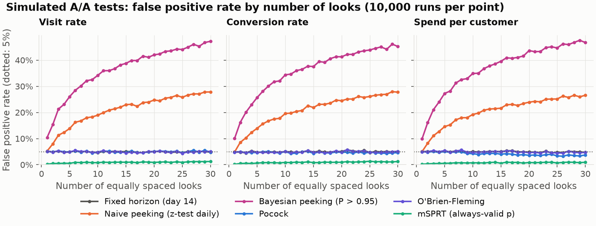
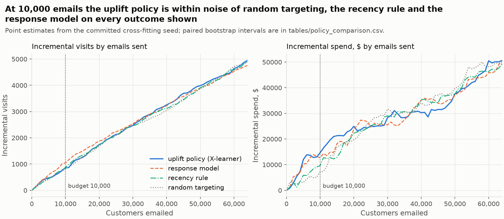

# Which email should we send, and to whom? The Hillstrom email experiment

[](https://github.com/tommasopongiluppi/experimentation-uplift/actions/workflows/ci.yml)

A decision memo on a randomised email experiment, backed by a tested Python package (`abkit`)
that produces every number below.
<!-- RESULTS:intro -->
64,000 customers were randomised to a Mens email, a Womens email or no email, and their visits, purchases and spend were tracked for 14 days (Hillstrom's MineThatData challenge, 2008).
<!-- /RESULTS:intro -->

## TL;DR

<!-- RESULTS:summary -->
**Decision: send the Mens email, to everyone who can be emailed.** Both emails beat sending nothing on spend, and the Mens email beats the Womens email. If only 10,000 emails can be sent, send them to the 10,000 most recent purchasers. The three rankings tested (response model, recency rule, uplift model) are not separated from each other; all three bring more conversions than random targeting, but none is shown to bring more visits or spend, so the case for targeting rests on conversions. The recency rule needs no model.

| Headline (two-week window) | Estimate | 95% interval | Adjusted p |
|---|---|---|---|
| Mens vs no email: spend per customer | +\$0.77 | \$0.49 to \$1.05 | <0.001 |
| Womens vs no email: spend per customer | +\$0.42 | \$0.17 to \$0.68 | 0.001 |
| Mens vs Womens: spend per customer | +\$0.35 | \$0.03 to \$0.66 | 0.030 |
| Mens vs no email: visit rate (10.6% → 18.3%) | +7.7 pp | 7.0 to 8.3 pp | <0.001 |

Adjusted p: rows 1 and 2, Holm across the 2 tests of the primary family (each email against no email on spend); rows 3 and 4, Benjamini-Hochberg across the 7 tests of the secondary family (every other comparison of spend, conversion and visits). Intervals are unadjusted.

- **Value.** Sent to all 64,000 customers, the Mens email brings about \$49,000 of extra revenue in two weeks (\$32,000 to \$67,000). Profit cannot be computed: the data hold no cost or margin.
- **Targeting 10,000 customers.** The response model, the recency rule and the uplift model are not separated from each other on visits, conversions or spend. Against random targeting all three bring more conversions (the recency rule +60 conversions, 3 to 126), but none is shown to bring more visits or spend.
- **Whom not to email.** Nobody identified. The 10,000 customers the model ranks lowest still visit more when emailed: +7.0 pp (5.3 to 8.8 pp).
<!-- /RESULTS:summary -->

The analysis plan was written and committed before any outcome was compared between arms
([docs/analysis_plan.md](docs/analysis_plan.md)); every later change is listed there as a
deviation. Numbers in this file are generated from `reports/results.json`, never typed.

## Contents

1. [The business questions](#1-the-business-questions)
2. [Is the experiment valid?](#2-is-the-experiment-valid)
3. [Results](#3-results)
4. [Two pitfalls, quantified](#4-two-pitfalls-quantified)
5. [Who to email](#5-who-to-email)
6. [How it is verified](#6-how-it-is-verified)
7. [Limitations](#7-limitations)
8. [Reproduce](#8-reproduce)
9. [Repository structure](#9-repository-structure)
10. [References](#10-references)

## 1. The business questions

These are the questions of the original challenge. Each answer is generated from the results.

<!-- RESULTS:questions -->
| # | Question | Answer |
|---|---|---|
| Q1 | Which email performed better, and on which metric? | The Mens email, on all three metrics. Against the Womens email: visit rate +3.1 pp (2.4 to 3.8 pp); conversion rate +0.37 pp (0.17 to 0.57 pp); spend per customer +\$0.35 (\$0.03 to \$0.66), each significant after adjustment. |
| Q2 | How much incremental spend per customer did each email drive? | Mens +\$0.77 (\$0.49 to \$1.05), a relative lift of +118%; Womens +\$0.42 (\$0.17 to \$0.68), a relative lift of +65%, on a no-email baseline of \$0.65 per customer. |
| Q3 | If only 10,000 customers can be emailed, who should get which email? | The uplift policy (each customer's better email, top 10,000 by predicted uplift) brings 852 extra visits (627 to 1,062). No ranking is separated from the others (the response model has the highest point estimate), so use the simplest one: the Mens email to the 10,000 most recent purchasers. |
| Q4 | Which 10,000 customers should not be emailed? | No such group was found. The 10,000 customers with the lowest predicted uplift still respond to their better email: +7.0 pp visits (5.3 to 8.8 pp). |
| Q5 | Do the effects differ across customer segments? | For the Womens email, yes: it lifts visits by +7.3 pp (6.4 to 8.2 pp) among past buyers of women's merchandise and by +1.1 pp (0.2 to 2.0 pp) among the rest (interaction adjusted p <0.001). 6 of its 21 interaction tests are significant after Benjamini-Hochberg, against 0 of 21 for the Mens email, whose effect is close to uniform. Exploratory, not a decision. |
<!-- /RESULTS:questions -->

## 2. Is the experiment valid?

Before reading any outcome, check that the randomisation worked: the arms should have the
planned sizes and look alike on everything measured before the email.

<!-- RESULTS:validity -->
- **Sample ratio mismatch: none.** Arm sizes are 21,307 (Mens), 21,387 (Womens) and 21,306 (no email) against an expected 21,333 each: chi-square 0.20 on 2 degrees of freedom, p = 0.90 (alarm threshold 0.001).
- **Balance: no variable flagged.** The largest absolute standardised mean difference between any two arms, over every pre-treatment variable and level, is 0.017 (`channel` = `phone`), against a threshold of 0.1; 0 are flagged. Chi-square tests of the categorical variables give p = 0.36 (`history_segment`), 0.58 (`zip_code`) and 0.46 (`channel`).
<!-- /RESULTS:validity -->

The data pass the validation suite ([reports/validation.md](reports/validation.md)). Only
variables measured before the email are used as covariates, features or segment definitions.

## 3. Results

Differences are the first arm minus the second, per customer, over the two weeks after the
email.

<!-- RESULTS:readout -->
| Metric | Comparison | Difference | 95% interval | Relative lift | Adjusted p |
|---|---|---|---|---|---|
| Spend per customer | Mens vs no email | +\$0.77 | \$0.49 to \$1.05 | +118% (63% to 192%) | <0.001 |
| Spend per customer | Womens vs no email | +\$0.42 | \$0.17 to \$0.68 | +65% (22% to 124%) | 0.001 |
| Spend per customer | Mens vs Womens | +\$0.35 | \$0.03 to \$0.66 | +32% (3% to 70%) | 0.030 |
| Conversion rate | Mens vs no email | +0.68 pp | 0.50 to 0.86 pp | +119% (77% to 171%) | <0.001 |
| Conversion rate | Womens vs no email | +0.31 pp | 0.15 to 0.47 pp | +54% (23% to 94%) | <0.001 |
| Conversion rate | Mens vs Womens | +0.37 pp | 0.17 to 0.57 pp | +42% (18% to 71%) | <0.001 |
| Visit rate | Mens vs no email | +7.7 pp | 7.0 to 8.3 pp | +72% (64% to 81%) | <0.001 |
| Visit rate | Womens vs no email | +4.5 pp | 3.9 to 5.2 pp | +43% (36% to 50%) | <0.001 |
| Visit rate | Mens vs Womens | +3.1 pp | 2.4 to 3.8 pp | +21% (16% to 26%) | <0.001 |

Spend against control is the primary family (2 tests, Holm); the other 7 comparisons are secondary (Benjamini-Hochberg). Spend uses Welch's t-test, rates a two-proportion z-test with Newcombe intervals.

- **Sensitivity.** With converters' spend winsorised at \$362.20, the differences against control are +\$0.74 (\$0.47 to \$1.00) for Mens and +\$0.41 (\$0.18 to \$0.65) for Womens. A percentile bootstrap of raw spend (10,000 resamples) gives \$0.49 to \$1.07 for Mens and \$0.18 to \$0.68 for Womens, so the normal approximation is not doing the work.
- **Bayesian readout** (Bayesian bootstrap on spend, 200,000 draws). P(Mens better than no email) = 1.000, credible interval \$0.49 to \$1.06. P(Womens better than no email) = 0.999, credible interval \$0.17 to \$0.68. P(Mens better than Womens) = 0.985, credible interval \$0.03 to \$0.66. The pre-registered rule (ship if P(better) is at least 0.95 and the expected loss is below 1% of the control mean) recommends the Mens email. The frequentist and Bayesian readouts agree, as expected with arms this large and a flat prior.
<!-- /RESULTS:readout -->



### Covariate adjustment

<!-- RESULTS:cuped -->
**CUPED and the regression adjustment barely reduce variance here.** CUPED removes a share of the variance equal to the squared correlation between the outcome and the pre-experiment covariate, and that correlation is tiny:

| Metric | Correlation with past-year spend | Variance removed by CUPED | Variance removed by Lin regression (15 covariates) |
|---|---|---|---|
| Spend per customer | 0.020 to 0.024 | 0.04% to 0.06% | -0.22% to -0.04% |
| Conversion rate | 0.026 to 0.032 | 0.07% to 0.10% | -0.24% to 0.27% |
| Visit rate | 0.063 to 0.067 | 0.40% to 0.44% | 2.81% to 2.91% |

- For spend, the standard error of the Mens effect goes from \$0.14525 to \$0.14522 with CUPED and to \$0.14528 with the regression, and the minimum detectable effect stays at \$0.3461 (\$0.3461 with CUPED). A negative value in the table means the adjustment added a little noise.
- **Why.** 99.1% of customers spend nothing in the two weeks, so spend is almost entirely a rare, noisy purchase event that last year's spend cannot predict (correlation at most 0.024). Visits are more predictable, and there the full regression removes up to 2.9%. CUPED pays off when the covariate is the same metric measured before the experiment on returning users; a one-off campaign with a two-week window is not that setting.
<!-- /RESULTS:cuped -->

## 4. Two pitfalls, quantified

The experiment itself was read once, at the end, with pre-registered families of tests. The
two simulations below show what the usual shortcuts would have cost.

### Peeking

<!-- RESULTS:peeking -->
Simulated experiments shaped like this one (21,306 customers per arm arriving evenly over 14 days, visit rate as in the control arm, 20,000 runs). Looking every day and stopping at the first p < 0.05 declares a winner in 21.9% of experiments in which the email does nothing, against 4.8% for a single test at the end.

| Rule, 14 daily looks | False positive rate, no true effect (± Monte Carlo SE) | Power at a 7.9% relative lift | Mean stopping day at that lift |
|---|---|---|---|
| One test at the end (no peeking) | 4.8% (±0.2%) | 79.0% (±0.3%) | 14.0 |
| Unadjusted test at every look, stop at the first p < 0.05 | 21.9% (±0.3%) | 87.0% (±0.2%) | 6.7 |
| Bayesian rule at every look, stop when P(better) leaves (0.05, 0.95) | 38.4% (±0.3%) | 93.0% (±0.2%) | 5.3 |
| Pocock boundary | 4.9% (±0.2%) | 65.8% (±0.3%) | 9.7 |
| O'Brien-Fleming boundary | 4.9% (±0.2%) | 77.3% (±0.3%) | 10.8 |
| Mixture SPRT (always-valid p-value) | 0.9% (±0.1%) | 46.5% (±0.4%) | 11.7 |

The group-sequential boundaries are calibrated by simulation; for five looks they come out at 2.416 (Pocock) and 2.040 (O'Brien-Fleming), against the published 2.413 and 2.04.
<!-- /RESULTS:peeking -->



The valid rules pay for early stopping with power, and the choice between them is a choice of
when to spend it: Pocock stops early more often, O'Brien-Fleming keeps almost all the power of
a single test, and the mixture SPRT allows a look after every customer at a higher price.

### Multiple testing

Cutting the customers into many segments and testing each one finds "effects" by chance.

<!-- RESULTS:multiple_testing -->
Simulation: 20 segments of 1,065 customers per arm, 10,000 runs.

| Scenario | Unadjusted tests at 0.05 | Benjamini-Hochberg at 0.05 |
|---|---|---|
| No segment has an effect: chance of at least one false discovery | 63.5% (theory 64.2%) | 4.7% |
| 5 of 20 segments have an effect: share of discoveries that are false | 14.8% | 3.9% |
| Same scenario: power to find a true effect | 74.7% | 47.8% |

**On the real data the correction changes little, because most of the effects are real.** Across 23 segment levels and two emails, the significant tests are 33 of 60 unadjusted and 26 after Benjamini-Hochberg for spend; 49 of 60 unadjusted and 47 after Benjamini-Hochberg for visits; 38 of 60 unadjusted and 36 after Benjamini-Hochberg for conversions. Both emails lift visits in nearly every segment, so there are few true nulls for the correction to protect against. The correction matters for the claim of a *difference between* segments, which is what the interaction tests in Q5 address.
<!-- /RESULTS:multiple_testing -->

## 5. Who to email

### Uplift models

An uplift model ranks customers by how much the email changes their behaviour, not by how
likely they are to respond anyway. Three meta-learners (S, T and X, on gradient-boosted
trees, cross-fitted so every score is out of fold) are compared with three baselines: a
response model, a recency rule and a random order.

<!-- RESULTS:uplift_models -->
| Ranking | Mens email vs no email | Womens email vs no email |
|---|---|---|
| S-learner | 0.008 (-0.006 to 0.023) | 0.060 (0.045 to 0.076) |
| T-learner | 0.010 (-0.004 to 0.025) | 0.051 (0.035 to 0.067) |
| X-learner | -0.002 (-0.017 to 0.013) | 0.063 (0.048 to 0.079) |
| Response model (baseline) | 0.023 (0.008 to 0.036) | 0.035 (0.021 to 0.050) |
| Recency rule (baseline) | 0.013 (0.000 to 0.027) | -0.004 (-0.020 to 0.013) |
| Random order (baseline) | -0.008 (-0.023 to 0.007) | -0.001 (-0.017 to 0.013) |

Normalised Qini coefficient on visits, out of fold, with 95% bootstrap intervals (1,000 resamples): 0 is a random ranking, 1 the best ranking the outcomes allow.

- **Womens email.** The X-learner ranks best, ahead of the random order, recency rule, response model and T-learner by a paired bootstrap difference, and is not separated from the S-learner.
- **Mens email.** The response model ranks best, ahead of the random order and X-learner by a paired bootstrap difference, and is not separated from the recency rule, S-learner and T-learner. No uplift learner beats the baselines: the email's effect on visits is close to the same for everyone, so there is little to rank.
- **Stability.** Repeating the cross-fitting under 10 fold seeds, the X-learner's coefficient on the Womens pair has median 0.062 (range 0.054 to 0.069) and is above the response model in 10 of 10 seeds.
- **The choice of the X-learner is post hoc (deviation D8).** It was picked for the policy after these results were seen, from three learners evaluated on the same data, so its coefficient is the largest of several noisy estimates and is optimistic. Read "best" as "chosen", not as "shown to be better".
<!-- /RESULTS:uplift_models -->

### The budgeted policy

Each policy picks the customers to email and the email each one gets.

<!-- RESULTS:policy -->
| Policy, 10,000 emails | Mens / Womens emails | Incremental visits (95% interval) | Incremental spend (95% interval) | Uplift policy minus this policy, visits |
|---|---|---|---|---|
| Uplift policy (X-learner) | 7,409 / 2,591 | 852 (627 to 1,062) | \$14,702 (\$6,314 to \$24,265) | reference |
| Response model | 7,975 / 2,025 | 1,047 (816 to 1,287) | \$12,698 (\$3,467 to \$22,614) | -195 (-441 to 12) |
| Recency rule | 10,000 / 0 | 879 (681 to 1,095) | \$9,683 (\$1,817 to \$18,121) | -27 (-276 to 204) |
| Random targeting (one draw) | 10,000 / 0 | 822 (645 to 990) | \$7,138 (\$1,077 to \$13,721) | +30 (-237 to 285) |

Values are increments over emailing nobody, estimated by inverse propensity weighting with the design probability, with a paired bootstrap (1,000 resamples). The recency rule and random targeting send the A/B winner (Mens).

- **The uplift policy is not separated from the response model** on visits, conversions or spend: every paired bootstrap interval includes zero. **The uplift policy is not separated from the recency rule** on visits, conversions or spend: every paired bootstrap interval includes zero. The recency rule and the response model are not separated from each other either. The response model has the highest point estimate on visits, but its lead over the recency rule, 168 visits (-57 to 423), includes zero. With no ranking separated from another the recommendation is the simplest one, the recency rule. The analysis plan pre-registered no rule for this choice.
- **Against random targeting** (the pre-registered draw), the paired differences in visits are +30 (-237 to 285) for the uplift policy, +225 (-33 to 492) for the response model and +57 (-177 to 291) for the recency rule, and in conversions +69 (6 to 129) for the uplift policy, +90 (24 to 159) for the response model and +60 (3 to 126) for the recency rule: none excludes zero on visits, all 3 exclude zero on conversions and none excludes zero on spend. So the case for targeting at all rests on conversions, an outcome the models were not trained on.
- **Budget curve.** Extending each ranking to every budget in steps of 1,000, the recency rule is at or above the uplift policy at 18 of 63 budgets on visits and at 32 of 63 on spend. At the budget of 10,000 it is above the uplift policy on visits (879 against 852). These are point estimates; the curves cross repeatedly and no ranking leads throughout.
- **Do-not-email list.** The 10,000 customers with the lowest predicted uplift, given their better email, gain +7.0 pp in visit rate (5.3 to 8.8 pp) and +\$0.98 in spend (\$0.41 to \$1.61). The model does not find customers who are better left alone.
<!-- /RESULTS:policy -->



The reason is in the model results above. The A/B winner lifts visits by about the same
amount for nearly everyone, so any rule that sends it to the same number of customers
collects about the same number of extra visits. The uplift model only has something to add
in choosing who gets the Womens email, which is a minority of the budget.

### Random targeting: one draw and its expectation

<!-- RESULTS:random_targeting -->
| Random targeting, 10,000 Mens emails | Pre-registered draw (bootstrap interval) | Exact expectation, budget times average effect (interval from the effect's) |
|---|---|---|
| Incremental visits | 822 (645 to 990) | 766 (700 to 832) |
| Incremental spend | \$7,138 (\$1,077 to \$13,721) | \$7,698 (\$4,851 to \$10,545) |

The draw is one random set of customers (analysis plan §11, deviation D9) and is what enters the paired comparisons above. The expectation needs no draw. The two differ by sampling noise, and the draw's interval is wider because it rests on the customers who happened to be drawn.
<!-- /RESULTS:random_targeting -->

## 6. How it is verified

Every statistical function has a test with a known answer. The simulation-based ones matter
most, because they can fail in ways a code review would not catch.

<!-- RESULTS:verification -->
| Check | What is tested | What it rules out |
|---|---|---|
| Interval coverage | The 95% intervals for rates, spend, CUPED, the Lin regression and the Qini bootstrap are computed on repeated simulated experiments with a known effect and must cover it about 95% of the time, within Monte Carlo error. | Intervals that are too narrow on zero-inflated, heavy-tailed spend. |
| Calibration | Credible intervals cover parameters drawn from the prior at their nominal rate; the two-part spend model recovers known parameters; out-of-fold uplift scores are checked by decile against observed effects. | A posterior or a model whose stated uncertainty or level is wrong. |
| Published boundary constants | The simulated five-look boundaries (2.416 and 2.040) match the published 2.413 and 2.04; with one look both reduce to the normal quantile; every valid rule holds its false positive rate. | A sequential simulation that is wrong in a way that still looks plausible. |
| Oracle rankings | On synthetic customers with a known individual effect, the true-effect ranking scores a normalised Qini of 1, random rankings average 0, and each learner ranks customers in line with the planted effect. | An uplift metric or learner that rewards likely responders, not persuadable ones. |
| Known answers | Every estimator is compared with scipy or statsmodels, a closed form or planted data: for example 20 null segments give at least one false discovery in 63.5% of runs against 64.2% in theory, and inverse propensity weighting recovers the known value of a fixed policy. | Formula and indexing errors. |
| Leakage guard | The feature builder refuses any outcome or arm column, and every score is out of fold. | Results inflated by information from the outcome. |
<!-- /RESULTS:verification -->

The slow simulations run on demand (`pytest -m slow`); everything else, including an
end-to-end run of the pipeline on a synthetic fixture, runs in CI on every push. The methods,
their formulas, assumptions and tests are written up in
[docs/methodology.md](docs/methodology.md).

## 7. Limitations

- **Old data.** The experiment ran in 2008. Email habits, inbox filtering and the retailer's
  customers have changed; the effect sizes should not be carried over to a campaign today.
- **A two-week window.** Purchases pulled forward from later weeks count as gains, and later
  effects, good or bad, are not seen.
- **No cost and no unsubscribe data.** Spend is revenue, not margin, and the cost of an email
  is set to zero. With no unsubscribes or complaints recorded, "email everyone" looks better
  here than it would with the full picture, and the search for customers who should not be
  emailed has no negative outcome to find.
- **A single experiment.** One campaign, one season, one creative per email. "Mens beats
  Womens" is a statement about these two emails, not about men's and women's merchandise.
- **Exploratory segments.** The segment analysis was pre-specified as exploratory. Its
  findings are hypotheses for a follow-up test, not decisions.
- **A post hoc model choice.** The learner behind the targeting policy was chosen after the
  model comparison was seen (deviation D8), with no held-out sample, so its results are
  optimistic by an unknown amount.
- **Noisy policy values.** Inverse propensity weighting uses only the customers whose random
  arm matches the policy, about a third of them, so the intervals are wide, above all for
  spend, where almost every customer contributes a zero. The intervals also treat the model
  scores as fixed and leave out the variability of fitting the models.
- **A stylised peeking study.** The data have no arrival dates, so the simulation assumes
  customers arrive evenly and outcomes are known at once. It shows the size of the problem
  and the cost of each fix, not what happened in this experiment.

## 8. Reproduce

```bash
git clone https://github.com/tommasopongiluppi/experimentation-uplift.git
cd experimentation-uplift
python3 -m venv .venv && source .venv/bin/activate
pip install -e ".[dev]"

# Download the data (checksum verified), run every stage, write reports/results.json,
# reports/tables/ and reports/figures/. Unchanged stages are skipped on later runs.
python -m abkit.pipeline run-all

# Optional: repeat the cross-fitting over fold seeds (slow).
python -m abkit.pipeline run-all --with-robustness

# Regenerate the numbers in this README from reports/results.json.
python -m abkit.report update-readme

# Tests: the fast suite, then the slow simulations.
pytest
pytest -m slow

# Optional: re-run the walkthrough notebook in place.
pip install -e ".[notebook]"
jupyter execute --inplace notebooks/walkthrough.ipynb
```

Python 3.11 or later. Seeds are fixed in `src/abkit/config.py`, so a re-run reproduces the
tables. `python -m abkit.pipeline run-all --fast --data tests/fixtures/hillstrom_fixture.csv
--out /tmp/abkit-demo` runs the whole pipeline on a small synthetic file without a download.
A short tour of the results is in [notebooks/walkthrough.ipynb](notebooks/walkthrough.ipynb).

## 9. Repository structure

```text
src/abkit/            the package
  sql/                DuckDB metric layer: per-arm sufficient statistics, balance, segments
  data.py, validate.py        download with checksum, validation, cleaning
  eda.py, balance.py          sample ratio mismatch, balance, pooled description
  frequentist.py, readout.py  tests, intervals, multiplicity, the readout tables
  cuped.py                    CUPED and the Lin regression adjustment
  bayes.py                    Beta-Binomial rates, Bayesian bootstrap and two-part spend model
  power.py                    minimum detectable effects, sample sizes, power curves
  sequential.py               peeking simulation and the valid sequential rules
  segments.py                 exploratory segment effects, interactions, false discovery rate
  uplift/                     features, cross-fitting, learners, evaluation, policies
  pipeline.py                 command line, stages and their cache
  report.py, readme.py        results.json, tables and the generated blocks of this file
  results_schema.py           the schema results.json is checked against
docs/                 analysis plan (frozen, with deviations), methodology, data card, schema
reports/              results.json, tables, figures, validation and description reports
notebooks/            walkthrough.ipynb
tests/                unit, known-answer and simulation tests; a synthetic fixture
.github/workflows/    CI on every push; slow tests on manual trigger
```

## 10. References

- Benjamini, Y. and Hochberg, Y. (1995). Controlling the false discovery rate: a practical and
  powerful approach to multiple testing. *Journal of the Royal Statistical Society: Series B*,
  57(1), 289-300.
- Deng, A., Xu, Y., Kohavi, R. and Walker, T. (2013). Improving the sensitivity of online
  controlled experiments by utilizing pre-experiment data. *Proceedings of WSDM 2013*.
- Hillstrom, K. (2008). The MineThatData e-mail analytics and data mining challenge.
  *MineThatData* blog.
- Jennison, C. and Turnbull, B. W. (2000). *Group Sequential Methods with Applications to
  Clinical Trials*. Chapman and Hall/CRC.
- Johari, R., Koomen, P., Pekelis, L. and Walsh, D. (2017). Peeking at A/B tests: why it
  matters, and what to do about it. *Proceedings of KDD 2017*.
- Kohavi, R., Tang, D. and Xu, Y. (2020). *Trustworthy Online Controlled Experiments: A
  Practical Guide to A/B Testing*. Cambridge University Press.
- Künzel, S. R., Sekhon, J. S., Bickel, P. J. and Yu, B. (2019). Metalearners for estimating
  heterogeneous treatment effects using machine learning. *Proceedings of the National
  Academy of Sciences*, 116(10), 4156-4165.
- Lin, W. (2013). Agnostic notes on regression adjustments to experimental data: reexamining
  Freedman's critique. *Annals of Applied Statistics*, 7(1), 295-318.
- O'Brien, P. C. and Fleming, T. R. (1979). A multiple testing procedure for clinical trials.
  *Biometrics*, 35(3), 549-556.
- Pocock, S. J. (1977). Group sequential methods in the design and analysis of clinical
  trials. *Biometrika*, 64(2), 191-199.
- Radcliffe, N. J. (2007). Using control groups to target on predicted lift: building and
  assessing uplift models. *Direct Marketing Analytics Journal*, 1, 14-21.
- Rubin, D. B. (1981). The Bayesian bootstrap. *Annals of Statistics*, 9(1), 130-134.

Released under the MIT licence ([LICENSE](LICENSE)).
