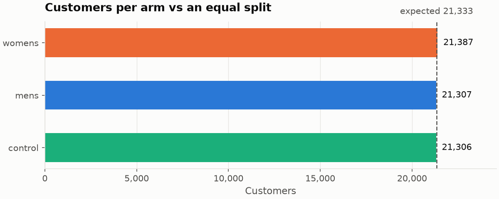
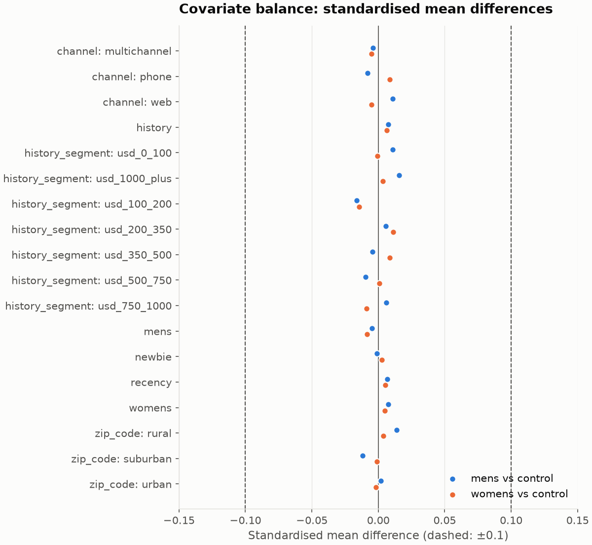
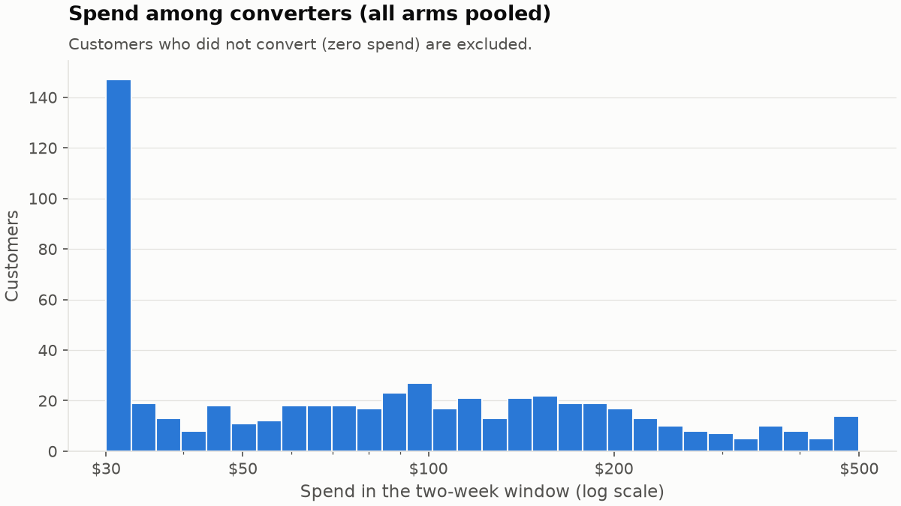
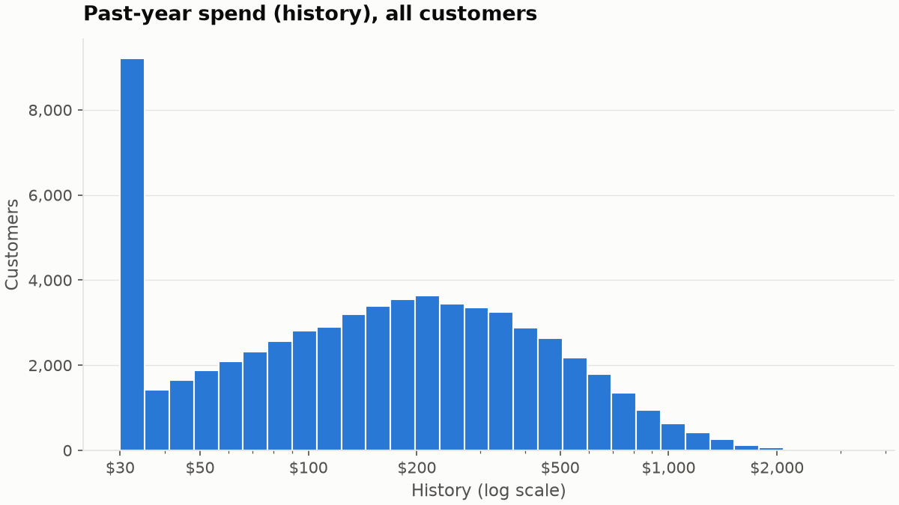
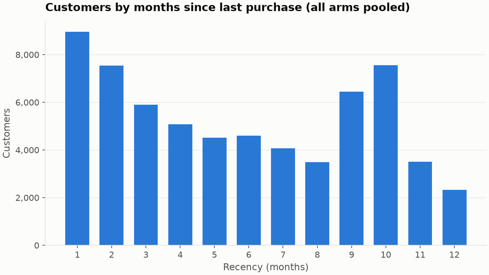

# Validity Checks and Pooled EDA

Generated by `abkit.eda` from the CSV files in `reports/tables/`; do not edit by hand.
Validity checks compare arms on assignment counts and pre-treatment variables only; the
EDA pools all customers and never splits an outcome by arm.

## 1. Sample ratio mismatch

Chi-square test against equal thirds: statistic 0.203 on 2 degrees of freedom, p = 0.904. The check fails if p < 0.001 (analysis plan §5): **PASSED**.

| Arm | Customers | Expected |
|---|---|---|
| control | 21,306 | 21,333.3 |
| mens | 21,307 | 21,333.3 |
| womens | 21,387 | 21,333.3 |

## 2. Covariate balance

Largest |SMD| across all variables, levels and comparisons: 0.0169 (channel: phone). Rows with |SMD| > 0.1: 0.

| Variable | Level | Mean mens | Mean womens | Mean control | SMD mens vs control | SMD womens vs control | SMD mens vs womens | Within ±0.1 |
|---|---|---|---|---|---|---|---|---|
| channel | multichannel | 0.1209 | 0.1206 | 0.1223 | -0.0042 | -0.0053 | 0.0011 | pass |
| channel | phone | 0.4337 | 0.4420 | 0.4378 | -0.0083 | 0.0086 | -0.0169 | pass |
| channel | web | 0.4454 | 0.4374 | 0.4399 | 0.0110 | -0.0051 | 0.0162 | pass |
| history |  | 242.8359 | 242.5366 | 240.8827 | 0.0076 | 0.0065 | 0.0012 | pass |
| history_segment | usd_0_100 | 0.3625 | 0.3569 | 0.3573 | 0.0109 | -0.0007 | 0.0116 | pass |
| history_segment | usd_1000_plus | 0.0218 | 0.0200 | 0.0195 | 0.0158 | 0.0035 | 0.0123 | pass |
| history_segment | usd_100_200 | 0.2202 | 0.2210 | 0.2270 | -0.0164 | -0.0143 | -0.0021 | pass |
| history_segment | usd_200_350 | 0.1920 | 0.1943 | 0.1898 | 0.0055 | 0.0114 | -0.0059 | pass |
| history_segment | usd_350_500 | 0.0984 | 0.1023 | 0.0997 | -0.0043 | 0.0087 | -0.0129 | pass |
| history_segment | usd_500_750 | 0.0750 | 0.0777 | 0.0775 | -0.0097 | 0.0006 | -0.0104 | pass |
| history_segment | usd_750_1000 | 0.0302 | 0.0277 | 0.0292 | 0.0061 | -0.0088 | 0.0149 | pass |
| mens |  | 0.5509 | 0.5489 | 0.5532 | -0.0046 | -0.0086 | 0.0040 | pass |
| newbie |  | 0.5015 | 0.5032 | 0.5020 | -0.0009 | 0.0026 | -0.0034 | pass |
| recency |  | 5.7736 | 5.7678 | 5.7497 | 0.0068 | 0.0052 | 0.0016 | pass |
| womens |  | 0.5514 | 0.5501 | 0.5476 | 0.0076 | 0.0049 | 0.0026 | pass |
| zip_code | rural | 0.1522 | 0.1487 | 0.1473 | 0.0137 | 0.0040 | 0.0097 | pass |
| zip_code | suburban | 0.4459 | 0.4512 | 0.4518 | -0.0117 | -0.0011 | -0.0107 | pass |
| zip_code | urban | 0.4019 | 0.4001 | 0.4009 | 0.0020 | -0.0018 | 0.0037 | pass |

Chi-square tests of independence between arm and each categorical variable:

| Variable | Levels | Chi-square | df | p-value |
|---|---|---|---|---|
| history_segment | 7 | 13.153 | 12 | 0.358 |
| zip_code | 3 | 2.872 | 4 | 0.579 |
| channel | 3 | 3.632 | 4 | 0.458 |

## 3. Pooled outcomes (all arms together)

- Customers: 64,000
- Visit rate: 14.68% (9,394 visitors)
- Conversion rate: 0.90% (578 converters)
- Share with zero spend: 99.10%
- Mean spend per customer: $1.051

## 4. Distributions

| Variable | Population | n | Mean | SD | Min | p50 | p90 | p99 | p99.9 | Max |
|---|---|---|---|---|---|---|---|---|---|---|
| history | all customers | 64,000 | 242.09 | 256.16 | 29.99 | 158.11 | 561.19 | 1,218.66 | 1,889.20 | 3,345.93 |
| spend | converters | 578 | 116.36 | 107.87 | 29.99 | 80.80 | 256.49 | 499.00 | 499.00 | 499.00 |
| recency | all customers | 64,000 | 5.76 | 3.51 | 1.00 | 6.00 | 10.00 | 12.00 | 12.00 | 12.00 |

| Recency (months) | Customers | Share |
|---|---|---|
| 1 | 8,952 | 0.1399 |
| 2 | 7,537 | 0.1178 |
| 3 | 5,904 | 0.0922 |
| 4 | 5,077 | 0.0793 |
| 5 | 4,510 | 0.0705 |
| 6 | 4,605 | 0.0720 |
| 7 | 4,078 | 0.0637 |
| 8 | 3,495 | 0.0546 |
| 9 | 6,441 | 0.1006 |
| 10 | 7,565 | 0.1182 |
| 11 | 3,504 | 0.0548 |
| 12 | 2,332 | 0.0364 |

## 5. Correlation of history with outcomes (input to CUPED)

CUPED with `history` multiplies the variance of an outcome by about 1 - r², where r is the Pearson correlation below (analysis plan §7).

| Outcome | n | Pearson r | r² |
|---|---|---|---|
| spend | 64,000 | 0.0217 | 0.0005 |
| visit | 64,000 | 0.0652 | 0.0042 |
| conversion | 64,000 | 0.0294 | 0.0009 |
